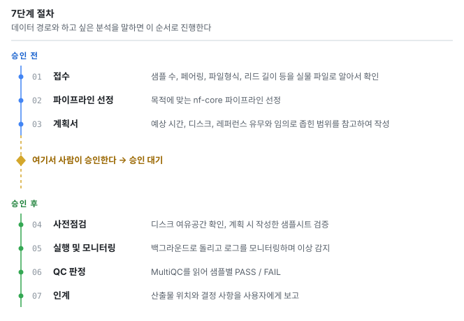
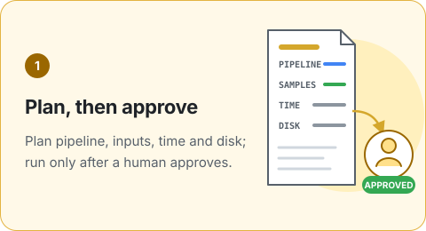
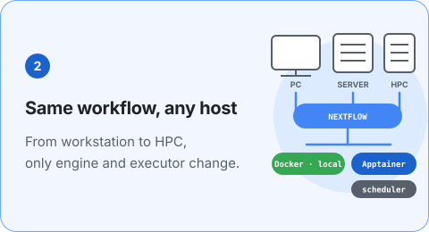
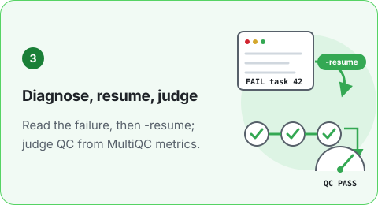
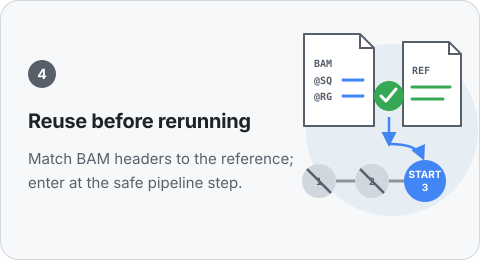
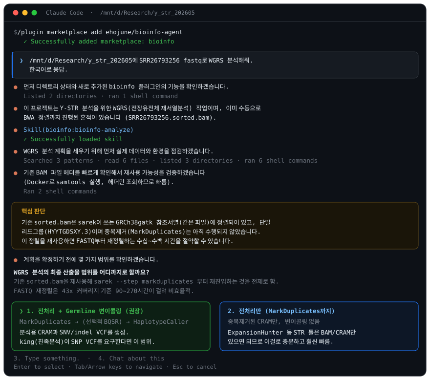

<p align="center">
  
</p>

<p align="center">
  
  
  
  
</p>

<p align="center">
  <a href="README.md">한국어</a> ·
  <b>English</b>
</p>

---

**A Claude Code skill and agent that turns a data path and an analysis question into a Nextflow run and a QC report.**

It prepares a samplesheet and estimates time and disk in `plan.md`, then waits for approval. After execution it delivers QC and outputs in `handoff.md`, using the workstation, WSL2, shared server or HPC environment.

**The Line — biological interpretation belongs to the researcher.** The agent reports expression, variants and QC metrics; it does not decide whether they support a biological hypothesis.

<p align="center">
  
</p>

## Why bioinfo-agent

Four checks make the path from a request to a reviewed result explicit.

<table>
<tr>
<td width="50%" valign="top">



[Plan before approval](#usage)

</td>
<td width="50%" valign="top">



[One procedure across hosts](docs/agent-setup.md)

</td>
</tr>
<tr>
<td width="50%" valign="top">



[Read failures and resume](#when-something-breaks)

</td>
<td width="50%" valign="top">



[Reuse existing work](#a-real-session)

</td>
</tr>
</table>

## Quick start

### Install the skill and agent — no clone needed

Run these two lines in a terminal with [Claude Code](https://code.claude.com/docs/en/setup) installed.

```bash
claude plugin marketplace add ehojune/bioinfo-agent
claude plugin install bioinfo@bioinfo
```

Give it the data path and analysis question to start selecting a pipeline and preparing a plan. Update with `claude plugin update bioinfo@bioinfo`. **Choose one installation route: plugin, or `install.ps1`/symlinks.**

### Prepare the execution environment

Ask Claude Code to prepare Nextflow, containers and references:

```text
https://github.com/ehojune/bioinfo-agent
Clone this and set it up so I can run pipelines in my environment.
```

The agent checks the host and permissions before setup. The plan estimates disk; large runs need space outside a limited home quota.

For manual setup, privileges and download scope, see [installation](docs/agent-setup.md) and [other hosts](docs/other-hosts.md).

## A real session

<p align="center">
  
</p>

This Y-STR session is in Korean; the agent uses your language. **Nobody asked it to check the BAM header.** Starting from `run a WGRS analysis on this fastq`, it found an existing `sorted.bam`, compared the header and alignment reference, and proposed re-entry at duplicate marking. **Then it stopped to ask how far to take the outputs.**

The 90–270 hours was an **estimate for re-alignment**, not a measured saving.

## Nextflow and nf-core

**[Nextflow](https://www.nextflow.io/)** connects analysis steps and manages container execution and intermediate caches. Its `-resume` option reuses cached work after a failure. **[nf-core](https://nf-co.re/pipelines)** is a collection of bioinformatics pipelines built on Nextflow with shared conventions.

```bash
nextflow run nf-core/rnaseq -r 3.18.0 -profile docker --input samplesheet.csv --outdir results
```

That line handles QC → trimming → alignment → quantification → report. **The agent assembles a command for your inputs and host, runs it and reads the results.** [`config/pipelines.tsv`](config/pipelines.tsv) defines the pinned versions, checked before launch.

## Usage

Describe your analysis instead of learning a new command:

```text
I have paired-end FASTQs from mouse liver in ~/data/rnaseq: 4 control and 4 treated samples.
I want expression differences. Check the inputs and show a plan with estimated time and disk first.
```

```text
My existing aligned BAMs are in /data/wgs. I want germline variants.
Check whether the alignments can be reused, then delegate execution to the bioinfo-tech agent.
```

| What you review | What you receive |
|---|---|
| Question, paths, species, genome build and study design | Input checks and a proposed pipeline |
| Scope, reuse and resource estimates in `plan.md` | Preflight and execution after approval |
| QC decisions and unresolved items | `handoff.md`, output locations, reproducible commands and logs |

The agent manages long runs in `tmux` for you. This cannot survive a reboot or WSL shutdown; the agent checks the preserved cache before resuming.

### Why it investigates before being asked

If “12 paired-end samples” turns out to be nine, that matters before launch. The agent checks counts, pairing, compression, containers, disk and reference paths.

**Checks before approval are read-only.** BAM headers and indexes help assess reuse; full-file statistics and analysis wait for approval. Ambiguous requests or missing evidence prompt a question and a stop.

## Supported pipelines

**19 nf-core pipelines and one in-repository pipeline** are prepared, within a tested scope. Pins live in [`config/pipelines.tsv`](config/pipelines.tsv); tested scope is in the [reference index](docs/reference/README.md).

| Analysis goal | nf-core pipelines | Main outputs / prepared scope |
|---|---|---|
| Transcriptomics and splicing | **rnaseq**, **differentialabundance**, **rnasplice** | Bulk RNA quantification, differential expression, alternative splicing |
| Genomics and variants | **sarek**, **raredisease** | Germline/somatic variants; raredisease covers alignment, QC and selected callers, with full clinical annotation requiring preparation |
| Epigenomics | **methylseq**, **atacseq**, **chipseq**, **cutandrun** | Methylation rates, accessibility/binding peaks, CUT&RUN/CUT&Tag |
| Single-cell and spatial | **scrnaseq**, **spatialaxe** | Count matrices; Xenium coordinate-based segmentation and QC |
| Metagenomes, microbes and viruses | **ampliseq**, **mag**, **taxprofiler**, **bacass**, **viralrecon** | 16S/ITS, metagenome assembly/profiling, bacterial assembly, viral consensus/variants |
| Long-read transcriptomics and methylation | **nanoseq**, **isoseq** | ONT alignment/methylation, PacBio Iso-Seq gene/transcript models |
| Public data acquisition | **fetchngs** | FASTQs and a downstream samplesheet |

The in-repository **[`pacbio-hifi-wgs`](pipelines/pacbio-hifi-wgs/)** accepts PacBio subreads, HiFi BAM/FASTQ and aligned BAM for germline SNVs/indels, SVs and phasing. It also has a DeepSomatic path for aligned tumor–normal BAMs. CLR uses a separate input path; its small-variant results are exploratory. See the pipeline README for input and caller limits.

Other pipelines are prepared and validated on request. Biological interpretation remains outside the agent's scope.

## When something breaks

```text
This run seems to have stopped. Diagnose its logs and trace read-only, then propose how to resume.
/data/run-directory
```

The agent uses `triage-run.sh` to distinguish run status from failed task attempts. **Keep the work directory:** `-resume` needs the cache. Installation checks and direct diagnostic commands are in the [operations reference](docs/reference/maintenance.md).

## Evidence and documentation

Execution completion, QC and truth-set accuracy are distinct. Examples include GIAB germline, HG008 tumor–normal and real inputs that failed QC. Results apply to the tested revision and inputs.

Researchers can start with the examples above. Reviewers can inspect [evidence and public runs](docs/reference/README.md); operators use [architecture](docs/agent-architecture.md) and [setup](docs/agent-setup.md). AI agents follow the [execution contract](skills/bioinfo-analyze/SKILL.md) and [runbook](skills/bioinfo-analyze/references/runbook.md).

[MIT License](LICENSE)
