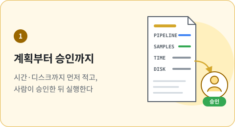
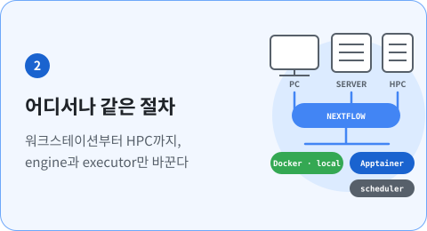
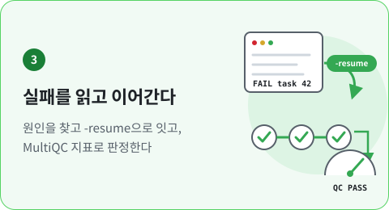
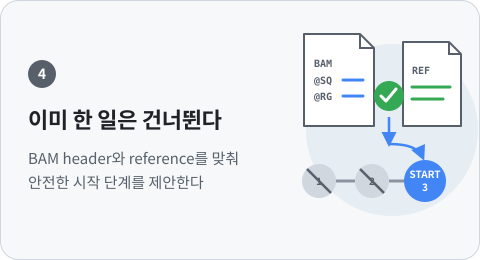

<p align="center">
  
</p>

<p align="center">
  
  
  
  
</p>

<p align="center">
  <b>한국어</b> ·
  <a href="README.en.md">English</a>
</p>

---

**데이터 경로와 분석 목적을 말하면 Nextflow 파이프라인을 골라 실행하고 QC 결과를 보고하는 Claude Code 스킬·에이전트다.**

샘플시트와 예상 시간·디스크를 `plan.md`에 적고 승인을 기다린다. 승인 후 실행해 QC 판정과 산출물을 `handoff.md`로 인계한다. 개인 PC·WSL2·공용 서버·HPC에 맞춰 환경을 설정한다.

**The Line — 생물학적 해석은 연구자의 몫이다.** 발현량·변이·QC 지표는 보고하지만 그 결과가 연구 가설을 뒷받침하는지는 판단하지 않는다.

<p align="center">
  
</p>

## 왜 bioinfo-agent인가

직접 명령을 조합하거나 범용 AI 대화만으로 돌릴 때 빠지기 쉬운 네 지점을 실행 절차로 묶었다.

<table>
<tr>
<td width="50%" valign="top">



[계획부터 승인까지](#사용법)

</td>
<td width="50%" valign="top">



[어디서나 같은 절차](docs/agent-setup.md)

</td>
</tr>
<tr>
<td width="50%" valign="top">



[실패를 읽고 이어간다](#문제가-생기면)

</td>
<td width="50%" valign="top">



[이미 한 일은 건너뛴다](#실제-세션)

</td>
</tr>
</table>

## 빠른 시작

### 스킬과 에이전트 설치 — clone 불필요

[Claude Code](https://code.claude.com/docs/en/setup)가 설치된 터미널에서 두 줄을 실행한다.

```bash
claude plugin marketplace add ehojune/bioinfo-agent
claude plugin install bioinfo@bioinfo
```

데이터 경로와 분석 목적을 말하면 파이프라인 선정과 계획서 작성부터 시작한다. 업데이트는 `claude plugin update bioinfo@bioinfo`다. **플러그인과 `install.ps1`·심링크 설치 중 한 경로만 쓴다.**

### 실제 실행 환경 준비

Nextflow·컨테이너·레퍼런스가 필요하다. 직접 세팅하지 않아도 된다. Claude Code에 다음처럼 요청한다.

```text
https://github.com/ehojune/bioinfo-agent
이거 clone 하고 내 환경에서 파이프라인을 돌릴 수 있게 설정해줘.
```

에이전트가 호스트와 권한을 확인해 설치 절차를 제안한다. 대용량 분석은 홈 쿼터 밖에 작업 공간을 잡고 필요한 용량은 계획서에서 계산한다.

직접 설치·권한·다운로드 범위는 [설치 가이드](docs/agent-setup.md)와 [다른 호스트](docs/other-hosts.md)를 따른다.

## 실제 세션

<p align="center">
  
</p>

Y-STR 프로젝트에서 실제로 오간 세션이다. **묻지 않은 것을 먼저 확인했다는 점**을 보자. `fastq로 WGRS 분석해줘`라는 요청에서 출발했는데, 예전에 만든 `sorted.bam`의 header와 정렬 reference를 대조하고 중복 마킹 단계부터 재진입하는 안을 냈다. **그리고 멈춰서 산출물 범위를 물었다.**

90–270시간은 재정렬 **예상 시간**이며 실측 절감량은 아니다.

## Nextflow와 nf-core

**[Nextflow](https://www.nextflow.io/)**는 분석 단계를 연결하고 컨테이너 실행과 중간 결과 캐시를 관리하는 워크플로 엔진이다. 실패 뒤 `-resume`으로 캐시를 재사용한다. **[nf-core](https://nf-co.re/pipelines)**는 Nextflow 위에 공통 규약으로 만든 생물정보학 파이프라인 모음이다.

```bash
nextflow run nf-core/rnaseq -r 3.18.0 -profile docker --input samplesheet.csv --outdir results
```

이 한 줄이 QC → 트리밍 → 정렬 → 정량 → 리포트를 처리한다. **에이전트는 내 입력과 환경에 맞는 명령을 조립하고 실행한 뒤 결과를 읽어준다.** 버전 기준은 [`config/pipelines.tsv`](config/pipelines.tsv)이며 실행 전에 대조한다.

## 사용법

별도 명령 대신 분석 목적을 말한다. 예를 들면:

```text
~/data/rnaseq에 마우스 간조직 paired-end FASTQ가 있어. 대조군 4샘플, 처리군 4샘플이야.
발현 차이를 보고 싶어. 입력을 확인하고 예상 시간과 디스크를 포함한 계획서를 먼저 보여줘.
```

```text
기존 정렬 BAM이 /data/wgs에 있어. germline 변이를 찾고 싶어.
정렬을 재사용해도 되는지 확인하고 bioinfo-tech 에이전트에게 실행을 맡겨줘.
```

| 내가 확인할 것 | 받는 결과 |
|---|---|
| 분석 질문·입력 경로·종·게놈 빌드·실험 설계 | 입력 확인과 파이프라인 제안 |
| `plan.md`의 분석 범위·재사용 여부·자원 추정치 | 승인 후 사전점검과 실행 |
| QC 판정과 미해결 항목 | `handoff.md`, 결과 위치, 재현 명령과 로그 |

긴 실행은 에이전트가 `tmux`에서 관리한다. 직접 조작할 필요는 없지만 재부팅·WSL 종료를 견디지는 못한다. 끊긴 실행은 보관된 캐시에서 재개를 검토한다.

### 왜 시키지 않은 조사를 먼저 하는가

설명과 실제 파일이 다르면 분석도 달라진다. “12샘플 paired-end”라고 했는데 파일은 9샘플뿐이라면 실행 전에 알아야 한다. 에이전트는 파일 수·페어링·압축 상태와 컨테이너·디스크·레퍼런스 경로를 먼저 확인한다.

**승인 전에는 읽기 전용 확인만 한다.** BAM header와 기존 index는 재사용 가능성을 판단하는 데 쓰지만 전체 파일을 훑는 통계 계산이나 분석은 승인 뒤에 한다. 요청이 모호하거나 근거가 부족하면 질문하고 멈춘다.

## 지원 파이프라인

**nf-core 19개와 자체 파이프라인 1개**를 준비했다. 모든 옵션·규모를 검증했다는 뜻은 아니다. 고정 버전은 [`config/pipelines.tsv`](config/pipelines.tsv), 검증 범위는 [참고 자료](docs/reference/README.md)에서 확인한다.

| 분석 목적 | nf-core 파이프라인 | 주 결과·준비 범위 |
|---|---|---|
| 전사체·스플라이싱 | **rnaseq** · **differentialabundance** · **rnasplice** | bulk RNA 정량, 발현 차이, alternative splicing |
| 유전체·변이 | **sarek** · **raredisease** | germline·체세포 변이; raredisease는 정렬·QC·일부 변이 호출, 전체 임상 주석은 별도 준비 |
| 후성유전체 | **methylseq** · **atacseq** · **chipseq** · **cutandrun** | 메틸화율, 접근성·결합 peak, CUT&RUN/CUT&Tag |
| 단일세포·공간전사체 | **scrnaseq** · **spatialaxe** | count matrix; Xenium 좌표 기반 segmentation·QC |
| 메타게놈·미생물·바이러스 | **ampliseq** · **mag** · **taxprofiler** · **bacass** · **viralrecon** | 16S/ITS, metagenome 조립·분류, 세균 조립, 바이러스 consensus·변이 |
| 롱리드 전사체·메틸화 | **nanoseq** · **isoseq** | ONT 정렬·메틸화, PacBio Iso-Seq gene/transcript 모델 |
| 공공데이터 수집 | **fetchngs** | FASTQ와 다음 단계용 샘플시트 |

**자체 [`pacbio-hifi-wgs`](pipelines/pacbio-hifi-wgs/)**는 PacBio subreads·HiFi BAM/FASTQ·정렬 BAM에서 germline SNV/indel·SV·phasing을 수행한다. 정렬된 tumor–normal BAM의 DeepSomatic 경로도 있다. CLR은 별도 입력 경로이며 small-variant 결과는 탐색용이다. 입력·caller별 한계는 해당 파이프라인 README를 따른다.

목록 밖의 파이프라인은 요청 시 준비하고 검증한다. 생물학적 해석은 지원 범위에 포함하지 않는다.

## 문제가 생기면

```text
이 실행이 멈춘 것 같아. 로그와 trace를 읽기 전용으로 진단하고 재개 방안을 알려줘.
/data/run-directory
```

에이전트는 `triage-run.sh`로 종료 상태와 실패 task를 구분한다. **작업 디렉터리를 지우지 않는다.** 캐시가 남아 있어야 `-resume`으로 이어갈 수 있다. 설치 점검과 직접 진단 명령은 [운영 참고](docs/reference/maintenance.md)에 있다.

## 검증과 문서

실행 완료, QC 통과, truth-set 정확도는 서로 다른 근거다. 공개 예제에는 GIAB germline·HG008 tumor–normal 검증과 QC에 실패한 실제 입력도 포함한다. 특정 버전·입력에서 얻은 결과를 모든 데이터에 일반화하지 않는다.

연구자는 위 사용 예시부터 시작한다. 심사위원은 [검증 근거·공개 예제](docs/reference/README.md), 운영자는 [아키텍처](docs/agent-architecture.md)와 [설치](docs/agent-setup.md), AI는 [실행 계약](skills/bioinfo-analyze/SKILL.md)과 [runbook](skills/bioinfo-analyze/references/runbook.md)을 따른다.

[MIT License](LICENSE)
