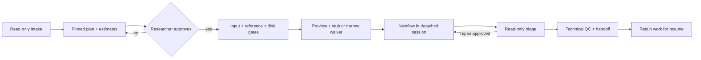

# Architecture and control boundaries

bioinfo-agent turns an approved analysis plan into a pinned Nextflow run and a
technical QC handoff. The contribution to evaluate is reliable workflow operation,
including reuse and recovery. Biological interpretation remains with the researcher.

| Reader | Start here | Authoritative detail |
|---|---|---|
| Researcher | [README](../README.en.md) | Request, approval, outputs |
| Reviewer/operator | [Five-minute review](reviewer-guide.md) | [Evidence tables](reference/evidence-tables.md), [control specification](reference/control-spec.md) |
| Execution agent | [SKILL](../skills/bioinfo-analyze/SKILL.md) | Selected pipeline card and runbook, loaded when needed |

The substrate (`bootstrap/`, `config/`) supplies paths, engines and limits. The skill
defines the protocol; `agents/bioinfo-tech.md` isolates execution and logs. These are
different layers from the **three reader audiences** above.

Approval is an agent protocol, not a cryptographically enforced authorization.
Nextflow completion and scientific QC are separate states: a completed run can have
a FAIL QC verdict.

| Mechanism | Inputs → decision → output | Enforcement boundary |
|---|---|---|
| Re-entry | BAM/CRAM header, reference manifest, index and requested outputs → compatible starting step → approved command | Agent reads headers in a pinned container; preflight validates selected paths. A header alone does not prove identity or complete data integrity. |
| Work retention | Tool command, work roots, PID/process evidence, handoff age → allow/deny cleanup | `PreToolUse` hook returns block status before a recognized tool call. It is not a kernel sandbox and does not cover arbitrary shell programs. |
| Storage and recovery | Work path, free space, logs, trace, JVM state → reject placement or classify failure → bounded diagnostic report | Preflight and triage scripts. Current `/mnt/*` detection is a path heuristic, not filesystem attestation. |
| Resource and QC limits | Host/VM capacity, JVM reserve, task requests, QC metrics → configured caps and verdict → run/handoff | Nextflow limits constrain declared requests; QC bands and interpretation boundary remain agent instructions. No claim of universal OOM prevention. |

Exact predicates, error paths and test links are in the
[control specification](reference/control-spec.md). The
[related-work comparison](reference/related-work.md) separates verified sources
from hypotheses about this design. No head-to-head superiority has been measured.

Host settings belong in parsed `config/host.env` and generated
`~/.config/bioinfo/env.sh`; specifications must use the active host's values.
Runtime state, declared configuration and observed measurements must not be conflated.

For the submission and filing sequence, see the [one-month plan](priorities.md).
This document describes implemented behavior; it makes no patentability determination.
